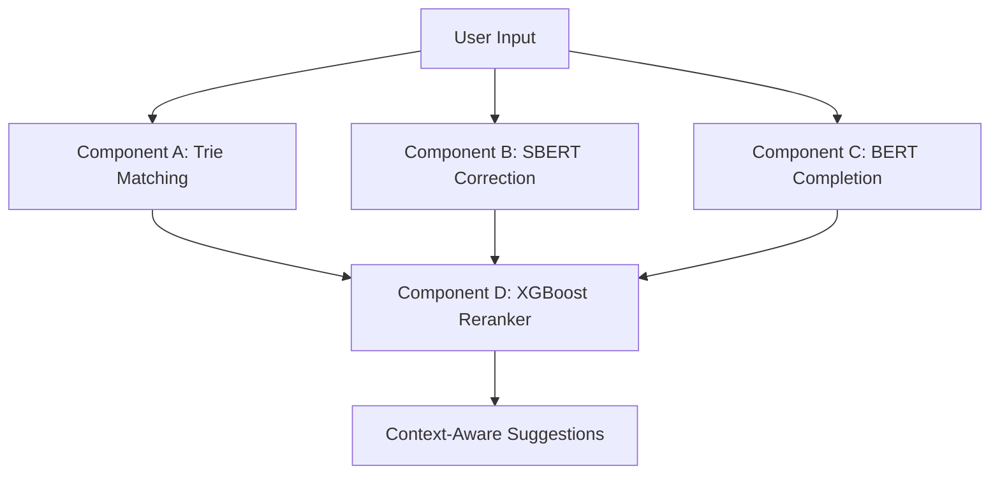
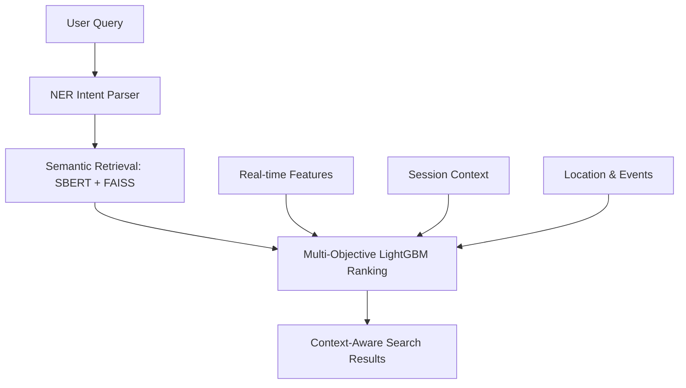

# 📑 High-Impact Technical Presentation Guide & Deck Template

This document provides:
1. **The Core Principles & Formula** derived from `flipkart-grid-ppt.pdf` for presenting complex AI/ML systems in `.md` and `.txt` format.
2. **The Complete 18-Slide Flipkart GRID 7.0 Presentation** rendered in clean, structured Markdown.

---

## 🎨 Part 1: How to Present Like Flipkart GRID in Markdown / Text

### 1. Structure & Visual Hierarchy
* **Slide Header & Subtitle**: Every section starts with an `H1` / `H2` title followed immediately by an italicized single-sentence summary (`### *[1-Line High Level Summary]*`).
* **Section Badging**: Use inline code tags (`[Component A]`, `product_catalog.csv`, `SBERT + FAISS`) for dataset names, models, algorithms, and technical modules to create visual focal points.
* **Dual-Column & Matrix Layouts**: Convert side-by-side slide elements into Markdown Tables or categorized bullet blocks (*Philosophy vs Architecture*, *Feature Categories*).
* **Concrete Examples (`Input ➔ Output`)**: Always back abstract ML concepts with explicit text examples (e.g. `"apple fon"` ➔ `"apple phone"`).
* **Native Flowcharts & Architecture**: Replace images of system pipelines with ASCII diagrams or `mermaid` flowchart blocks.
* **Empirical Benchmarks**: Place load test results and performance metrics inside code blocks or structured summary cards.

---

## 📊 Part 2: Transcribed Flipkart GRID 7.0 Deck (`presentation.md`)

```markdown
# 🚀 Flipkart GRID 7.0: Next-Gen E-Commerce Search & Autosuggest
### Team: Vision Voyagers

---

## 1. The Challenge
### *Flaws in Current E-Commerce Search*

#### 🔴 Autosuggest Limitations
* **Popularity-Based Trie Dependence**: Relies primarily on Trie structures with limited context awareness.
* **Poor Typo & Semantic Handling**: `apple fon` fails to suggest `apple phone`.
* **Lack of Real-Time Personalization**: Omits event-based and contextual suggestions.
* **Limited Intent Recognition**: Basic prefix matching fails on user context.

#### 🔴 Search Results Page (SRP) Issues
* **Inverted Index Bottlenecks**: Fails to capture semantic relationships.
* **Static Ranking Algorithms**: Does not adapt to real-time user session behavior.
* **Long-Tail Performance**: Drops relevance when exact keyword matches are rare.
* **Missing Dynamic Attributes**: Lacks integration for real-time inventory and delivery speeds.

> ⚠️ **Business Impact**: Higher bounce rates, increased user effort, and missed conversion opportunities across India's diverse linguistic patterns.

---

## 2. The Mission
### *Reimagining Search for Every Indian Shopping Journey*

> 🎯 **Core Challenge**: Design & build next-generation Autosuggest and SRP systems to ensure *"Every commerce search in India begins with Flipkart"*.

### Key Objectives
1. **Intelligent Autosuggest**: Reduce typing effort through semantic understanding, typo correction, and context-awareness.
2. **Precision Retrieval**: Enable semantic product discovery beyond exact keyword matching.
3. **Context-Aware Ranking**: Deliver personalized results accounting for session history, location, and real-time events.
4. **Seamless Experience**: Minimize friction while maximizing discovery and conversion.

**Success Metrics**: Improved query suggestion accuracy, lower search abandonment, higher CTRs, and elevated user satisfaction.

---

## 3. The Fuel
### *Comprehensive Dataset Architecture*

*Leveraging structured datasets to power every phase of the search journey:*

* 📦 **Core Product Intelligence** (`product_catalog.csv`): 10+ major categories with detailed specifications for multi-faceted filtering.
* 👤 **User Behavior Analytics** (`user_queries.csv`, `session_log.csv`): Raw user intentions, query patterns, and multi-location interactions.
* ⚡ **Real-time Context** (`realtime_product_info.csv`): Dynamic attributes (location delivery, pricing, stock, offers).
* 🏷️ **Named Entity Recognition (NER)** (`ner_dataset.csv`): Query annotations for extracting brand, category, price, and attribute entities.
* 📊 **Persona Intelligence** (`query_product_training.csv`): Behavioral patterns, price preferences, and brand affinities for profiling.

---

## 4. User Intelligence Engine
### *Advanced User Understanding Through Behavioral Analysis*

*Moving beyond static demographics to real-time dynamic behavioral profiles.*

#### Engineered Features
* `avg_price_last_k_clicks`: Spending patterns & price sensitivity.
* `preferred_brands_count`: Brand loyalty vs. exploration ratio.
* `session_length`: Browsing intensity & decision duration.
* `query_frequency`: Platform familiarity & domain knowledge.

#### Persona Classifications
* 💎 **Brand Loyalists**: High brand preference, consistent price ranges.
* 🏷️ **Budget Optimizers**: Price sensitive, driven by deals/offers.
* 🔍 **Explorers**: High category breadth, diverse browsing patterns.
* ⭐️ **Quality Hunters**: Short sessions, heavily review-driven.

> 🚀 **Impact**: Tailored suggestions, personalized ranking weights, and relevant promotions to drive conversions.

---

## 5. Autosuggest System Architecture
### *Intelligent Query Assistance Through Multi-Modal AI*

#### System Philosophy
Moving from *"what users type"* to *"what users mean"*, bridging user intention and system capability.

#### Multi-Modal Pipeline Diagram



---

## 6. Component A — Prefix Match with Trie
### *Lightning-Fast Foundational Matching*

> Custom Trie structure storing corrected queries from `user_query_log.csv`, achieving O(k) lookup time where k = prefix length.

* **Strategic Value**: Ensures sub-millisecond baseline speed before applying semantic AI layers.
* **Data Integration**: Uses `corrected_query` and `frequency` to reflect real language patterns.
* **Highlights**:
  * ⚡ Sub-millisecond response times for millions of queries.
  * 🗜️ Compressed prefix sharing reduces memory footprint.
  * 📱 Zero network dependency (crucial for mobile networks).
  * 📈 Linear scaling with vocabulary size, independent of user traffic growth.

---

## 7. Component B — Semantic Correction using SBERT
### *Intelligent Error Understanding and Correction*

> Handles typos, non-standard terms, and abbreviations (e.g., `apple fon` ➔ `apple phone`).

#### Technical Workflow
1. User enters misspelled/noisy query string.
2. Generate dense vector via `all-MiniLM-L6-v2` SBERT model.
3. Retrieve top-3 semantically similar valid queries via **FAISS** vector index.
4. Pass candidates to downstream re-ranker.

#### Key Strengths
* **Semantic Understanding**: Maps true intent regardless of spelling errors.
* **Multilingual Robustness**: Seamlessly handles Hinglish / code-mixed queries.
* **High Performance**: Built to support **>10,000 QPS**.

---

## 8. Component C — Context-Aware BERT Completion
### *Predictive Query Intelligence*

> Uses `DistilBERT` masked language modeling to predict intended search terms from minimal input prefixes.

* **Example Input**: `"blu"` ➔ **Outputs**: `"blue jeans for men"`, `"bluetooth headphones"`, `"blue dress for women"`.

#### Contextual Drivers
* 🗓️ **Seasonal Relevance**: `"fest"` during Diwali ➔ `"festival wear"`.
* 📍 **Geographic Context**: Location-specific product demand.
* 📜 **User History**: Past queries guide intent completion.

#### Why DistilBERT?
* Bidirectional context awareness (surpasses traditional n-grams).
* Robust to input noise.
* Lightweight footprint optimized for real-time inference.

---

## 9. Component D — XGBoost Reranker
### *Intelligent Suggestion Prioritization*

> Re-ranks candidate output from Trie, SBERT, and BERT based on conversion probability and context.

#### Input Feature Signals
1. **Query Frequency**: Global popularity index.
2. **Semantic Similarity**: Vector cosine distance score.
3. **Session Context**: Recent browsing behavior alignment.
4. **Temporal Boosts**: Sales events, festivals, seasonality.
5. **Predicted Conversion**: Historical purchase probability.

#### Reranking Feature Categories
* 📊 **Frequency Analysis**: Recency & demographic weighting.
* 🧠 **Context Matching**: Session history distance scoring.
* 💼 **Business Intelligence**: Blending business goals with user intent.
* 👤 **Personalization**: Persona alignment score.

---

## 10. Search Results Page (SRP) Overview
### *Precision Product Discovery Through Multi-Stage Intelligence*



* **Philosophy**: Understands not just *what* users search for, but *why* they search and their purchase propensity.

---

## 11. Intent Parsing with NER
### *Transforming Natural Language into Structured Understanding*

> Fine-tuned **BERT NER** model extracts structured entities directly from unstructured search queries.

#### Query Breakdown Example
> Query: `"blue nike shoes under 2000 for running"`

* 👟 **Product Type**: `"shoes"` ➔ Category Filter
* 🏷️ **Brand**: `"nike"` ➔ Brand Filter
* 🎨 **Color**: `"blue"` ➔ Attribute Filter
* 💰 **Price**: `"under 2000"` ➔ Price Range
* 🏃 **Use Case**: `"for running"` ➔ Occasion Filter

#### Impact
* Auto-populates UI filter chips.
* Reduces manual filtering effort & cognitive load for shoppers.
* Outperforms brittle Regex patterns on complex syntax variations.

---

## 12. Semantic Product Retrieval
### *Moving Beyond Keyword Matching to Meaning-Based Discovery*

> Bridges vocabulary gaps (e.g., query `"budget phone"` matches product `"affordable smartphone"`).

#### Matching Pipeline
`Query Vector Encoding` ➔ `FAISS Top-100 Similarity Search` ➔ `Context Integration` ➔ `Hybrid Keyword + Vector Result Fusion`

#### Long-Tail Query Coverage
* `"phone for photography"` ➔ Matches `"camera smartphone"`
* `"laptop for students"` ➔ Matches `"study notebook"`
* `"dress for interview"` ➔ Matches `"formal attire"`

---

## 13. Multi-Objective LightGBM Ranking
### *Intelligent Product Prioritization for Maximum Relevance*

#### Feature Signal Matrix

| 👤 Personalization Signals | ⭐️ Quality Indicators | 💼 Business Intelligence | 🎯 Relevance Features |
| :--- | :--- | :--- | :--- |
| `session_intent_match` | `product_rating` | `offer_strength` | `semantic_score` (FAISS) |
| `price_gap_to_avg` | `review_count` | `is_f_assured` | `brand_match` |
| `contextual_boost` | `seller_rating` | `delivery_speed_score` | `semantic_similarity` |

> ⚖️ **Multi-Objective Optimization**: Balances high user relevance with platform revenue goals, delivery speed, and conversion rates.

---

## 14. Contextual Intelligence Engine
### *Location, Time, and Event-Aware Personalization*

1. **Session-Aware Personalization**:
   * Tracks query refinement trajectories over time.
   * Identifies intra-session budget limits and brand affinities.
2. **Geographic Intelligence**:
   * Prioritizes items available in local fulfillment centers for hyper-fast delivery.
   * Regional cultural & seasonal preference adjustments.
3. **Event-Driven Adaptations**:
   * **Festivals**: Diwali, Eid, Christmas product boosts.
   * **Sales**: Big Billion Days & flash sale event weighting.
   * **Personal**: Birthday & anniversary milestone recommendations.

---

## 15. End-to-End System Architecture
### *Scalable, Production-Ready Design*

```
┌─────────────────────────────────────────────────────────────────────────────┐
│                                 DATA LAYER                                  │
│  [Persona Training]  [Session Logs]  [User Queries]  [NER Data]  [Catalog]  │
└──────┬────────────────────┬──────────────┬──────────────┬────────────┬──────┘
       │                    │              │              │            │
       │                    │  ┌───────────┴──────────────┴──────────┐ │
       │                    │  │       AUTOSUGGEST PIPELINE          │ │
       │                    │  │  [User Input]                       │ │
       │                    │  │    ├─► [BERT Completion] ┐          │ │
       │                    │  │    ├─► [SBERT Correction]┼►[XGBoost]│ │
       │                    │  │    └─► [Trie Match]      ┘          │ │
       │                    │  └──────────────────┬──────────────────┘ │
       │                    │                     │                    │
       │                    ▼                     ▼                    │
       │  ┌─────────────────────────────────────────────────────────┐  │
       └──► SRP PIPELINE                                            │  │
          │ [Context Engine] ──► [LightGBM Ranking] ◄── [SBERT FAISS]◄──┘
          └─────────────────────────────────────────────────────────┘
```

#### Core System Properties
* 🛡️ **High Availability**: Distributed microservices with automated failover.
* ⚡ **Real-Time Performance**: Sub-100ms latency across the entire stack.
* 📉 **Scalable Design**: Sustains millions of concurrent shoppers and product SKUs.

---

## 16. Performance & Benchmark Results

### 🧪 Load Test Benchmark Report

#### Scenario A: Standard / Grammatical Queries
```text
Total Requests    : 1,000,000
Success Rate      : 100% (1,000,000 / 1,000,000)
Total Execution   : 72.77 sec
Throughput        : 13,741.96 req/sec
Avg Response Time : 0.0056 sec (5.6 ms)
```

#### Scenario B: Complex / Vague / Noisy Queries
```text
Total Requests    : 1,000,000
Success Rate      : 100% (1,000,000 / 1,000,000)
Total Execution   : 128.15 sec
Throughput        : 7,803.23 req/sec
Avg Response Time : 0.0126 sec (12.6 ms)
```

---

## 17. Conclusion & Impact

> *"Empowering Every Indian's Dream through Intelligent Search Innovation"*

* **GitHub Repository**: [github.com/sr2echa/flipkart-grid](https://github.com/sr2echa/flipkart-grid)
* **Team Members**: Sreecharan S, Shiv Dixit, Siddharth Nayak, Ronit Korat
```
